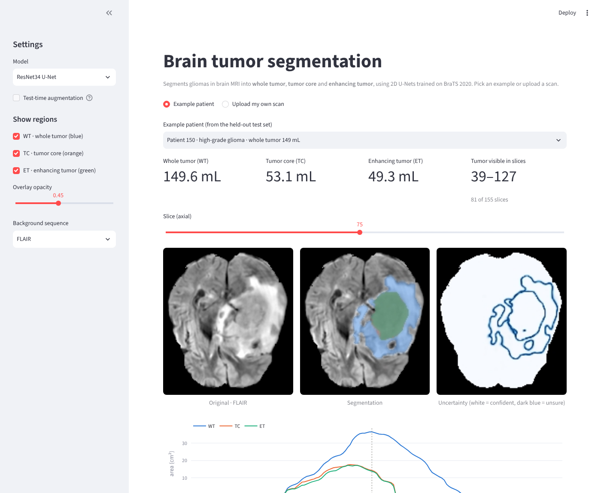
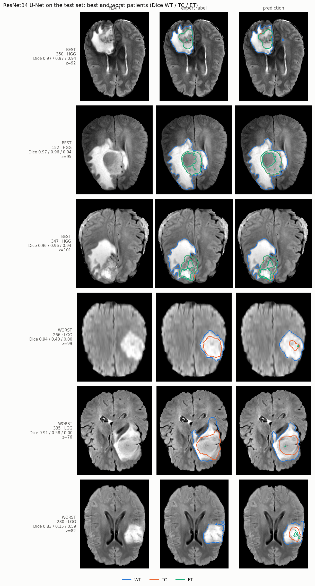
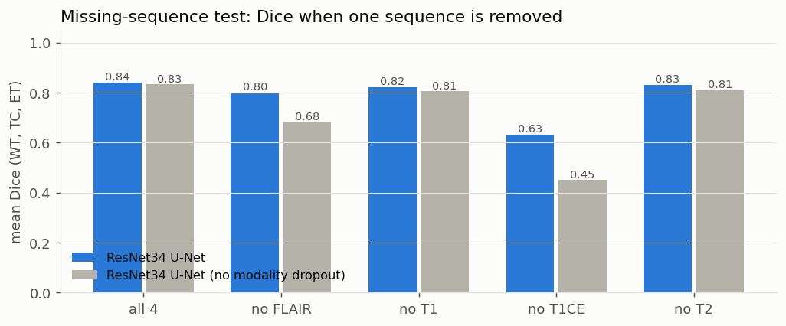
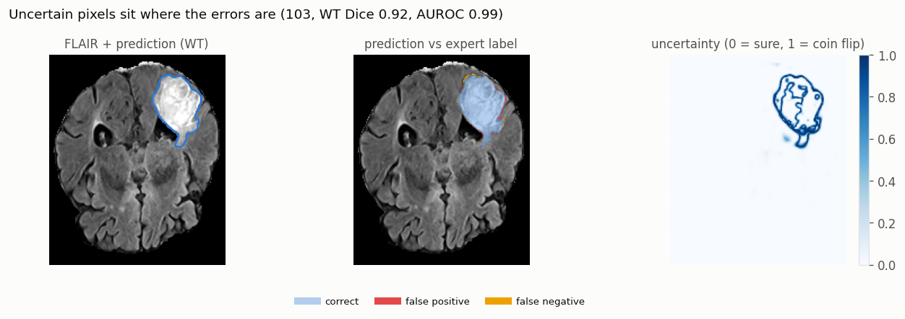

# Brain tumor segmentation (BraTS 2020)

Segments gliomas in brain MRI into the three regions clinicians care about —
**whole tumor (WT)**, **tumor core (TC)** and **enhancing tumor (ET)** — from four MRI
sequences (FLAIR, T1, T1ce, T2), and reports their volumes in mL with a per-voxel
uncertainty map. Three 2D U-Net variants are compared, and the models keep working
when a sequence is missing.

**Live demo:** _link added after deployment_ · research / education use only, not for diagnosis.



## Why this is hard

Gliomas vary hugely in size, shape and appearance; the enhancing rim can be a few
millimetres thick; tumor is often < 2% of a slice; scans come from 19 institutions
with different scanners. Real-world scans may also lack a sequence.

## Approach

| | |
|---|---|
| Data | BraTS 2020 training set: 369 patients, 4 co-registered 1 mm³ sequences + expert labels |
| Split | by **patient**, 70/15/15 (258/55/56), stratified by tumor grade |
| Input | per-sequence z-score on brain voxels, 192 px crop around the brain → 160×160 axial slices |
| Models | plain U-Net · Attention U-Net · U-Net with ImageNet ResNet34 encoder |
| Training | Dice + BCE, augmentation, **modality dropout** (randomly blank one sequence), early stopping on per-patient validation Dice |
| Evaluation | full 3D reconstruction at native resolution: Dice, HD95 (mm), volume error (mL); test-time augmentation; missing-sequence test; uncertainty vs. error |
| Deployment | Streamlit app, CPU, half-precision weights |

Every choice is explained in [`docs/decisions.md`](docs/decisions.md); the data
audit is in [`notebooks/01_data_audit.ipynb`](notebooks/01_data_audit.ipynb).

## Results (test set, 56 patients)

56 held-out patients that were never used for training or model selection, scored
in 3D at the original 1 mm resolution. Mean (median) over patients; full tables in
[`reports/eval/test/results.md`](reports/eval/test/results.md), figures and
discussion in [`notebooks/02_results.ipynb`](notebooks/02_results.ipynb).

| model | Dice WT | Dice TC | Dice ET | HD95 WT (mm) | \|volume error\| WT (mL) |
|---|---|---|---|---|---|
| U-Net | 0.902 (0.924) | 0.826 (0.880) | 0.793 (0.868) | 8.7 (3.7) | 7.7 (5.9) |
| Attention U-Net | 0.906 (0.933) | 0.829 (0.901) | 0.783 (0.861) | 7.7 (3.2) | 7.6 (4.8) |
| **ResNet34 U-Net** ★ | 0.900 (0.920) | 0.834 (0.906) | 0.787 (0.864) | 19.6 (6.0) | 7.6 (4.4) |
| ResNet34 U-Net, no modality dropout | 0.903 (0.930) | 0.835 (0.903) | 0.760 (0.860) | 12.8 (4.0) | 6.3 (2.9) |

★ Default model in the app, picked by **validation** Dice (0.825 vs 0.821–0.822), not by the test score.

**What the numbers say**

- **The architecture barely matters here.** All four models are within ~0.01 Dice of
  each other, less than the spread between patients. With careful preprocessing, a
  2D U-Net's backbone is not the bottleneck; the pretrained encoder mainly converged
  faster (best validation score at epoch 10).
- **Mean HD95 ≫ median HD95.** A few patients get a small false-positive blob far
  from the tumor, which barely changes Dice but costs tens of millimetres of HD95.
  The typical boundary error is 3–6 mm.
- **Enhancing tumor is the hardest region.** Some low-grade gliomas have no enhancing
  tumor at all; predicting even 0.2 mL there gives Dice 0. The three worst test
  patients are all low-grade, while their whole tumor is still found well (Dice 0.83–0.94).



### Missing sequences: modality dropout works

Mean Dice WT / TC / ET of the ResNet34 U-Net when one sequence is removed (set to zero):

| removed | trained with modality dropout | trained without |
|---|---|---|
| — (all 4) | 0.900 / 0.834 / 0.787 | 0.903 / 0.835 / 0.760 |
| FLAIR | **0.834** / 0.800 / 0.765 | 0.583 / 0.746 / 0.717 |
| T1 | 0.893 / 0.801 / 0.772 | 0.885 / 0.789 / 0.743 |
| T1ce | 0.895 / **0.658 / 0.342** | 0.887 / 0.412 / 0.049 |
| T2 | 0.889 / 0.822 / 0.783 | 0.875 / 0.784 / 0.771 |

Randomly blanking one sequence during training costs nothing when all four are
present and makes the model far more robust: without FLAIR, whole-tumor Dice stays at
0.83 instead of collapsing to 0.58. T1ce stays essential for enhancing tumor — by
definition, that is the region that lights up after contrast — but even there the
model keeps 0.34 instead of 0.05.



### Uncertainty and test-time augmentation

- **The uncertainty map points at the errors.** Across all models, uncertainty
  separates wrong from right voxels with AUROC 0.97; the 1% most uncertain voxels
  are wrong 27–30% of the time versus 0.7–0.8% for all other voxels (35–40× more often).
- **Test-time augmentation helps a little:** +0.001 to +0.007 Dice (+0.023 ET for the
  model without modality dropout), for ~1.4× the time on a GPU and ~2.6× on a CPU.
  It is an option in the app, off by default.
- **Speed:** ~2.2 s per patient on a Kaggle T4 GPU; ~10 s on a 4-core cloud CPU,
  which is what the hosted app runs on.



## Run it locally

```bash
git clone https://github.com/akhilnathreddy/brain-tumor-seg && cd brain-tumor-seg
python3 -m venv .venv && source .venv/bin/activate

# just the app (uses the weights in models/)
pip install -r requirements.txt
streamlit run app.py

# full pipeline
pip install -r requirements-train.txt
kaggle datasets download awsaf49/brats20-dataset-training-validation -p data/raw   # needs a Kaggle API token
python -m src.preprocess          # ~6 min, ~11 GB cache in data/processed
python -m src.audit               # data audit → reports/audit/
python -m src.train --run configs/runs/resunet34.yaml --estimate   # time estimate
python -m src.train --run configs/runs/resunet34.yaml              # also: unet, attunet, resunet34_nomd
python -m src.evaluate            # test set, once → reports/eval/test/
python -m src.report              # tables + figures
python -m src.export --benchmark  # fp16 weights + ONNX → models/, speed → reports/benchmark.json
```

On Apple Silicon training uses the GPU via MPS automatically
(`PYTORCH_ENABLE_MPS_FALLBACK=1` is set for unsupported ops).

### Train on a free Kaggle GPU instead

The final models were trained this way: one unattended run on a Kaggle T4 that
preprocesses the data, trains all four models, evaluates on the test set and
exports the weights.

```bash
kaggle kernels push -p kaggle --accelerator NvidiaTeslaT4   # needs a phone-verified Kaggle account
kaggle kernels status <your-username>/brain-tumor-seg-train
kaggle kernels output <your-username>/brain-tumor-seg-train -p kaggle-out   # when COMPLETE
```
Change the `id` in `kaggle/kernel-metadata.json` to your username first.

## Repository

```
src/          data loading, preprocessing, models, training, evaluation, inference, export
configs/      data settings, patient split, one YAML per training run
notebooks/    01 data audit · 02 results
models/       exported half-precision weights used by the app
examples/     3 test-set patients bundled with the app
kaggle/       script + settings to train everything on a Kaggle GPU
reports/      audit and evaluation outputs
docs/         decisions.md (why), app screenshot
app.py        Streamlit demo
```

## Limitations

- **2D, slice by slice.** The model sees one axial slice at a time, so it can't use
  context from neighbouring slices the way a 3D network does; predictions can be
  slightly inconsistent between slices.
- **Pre-operative gliomas only.** No post-surgery scans, metastases or other tumor types.
- **Research data that is already preprocessed.** BraTS scans are skull-stripped,
  co-registered and resampled to 1 mm. Raw hospital scans need the same steps first
  (e.g. HD-BET for skull stripping, registration to a common template).
- **Low-grade gliomas are under-represented** (~20% of patients), and many have no
  enhancing tumor, which makes ET hard to score for them.
- Not validated for clinical use.

## Data and citation

BraTS 2020 (Kaggle copy `awsaf49/brats20-dataset-training-validation`). As requested by the organizers, please cite:

1. B. H. Menze et al., "The Multimodal Brain Tumor Image Segmentation Benchmark (BRATS)", *IEEE TMI* 34(10), 2015. doi:10.1109/TMI.2014.2377694
2. S. Bakas et al., "Advancing The Cancer Genome Atlas glioma MRI collections with expert segmentation labels and radiomic features", *Scientific Data* 4:170117, 2017. doi:10.1038/sdata.2017.117
3. S. Bakas et al., "Identifying the Best Machine Learning Algorithms for Brain Tumor Segmentation, Progression Assessment, and Overall Survival Prediction in the BRATS Challenge", arXiv:1811.02629, 2018.
